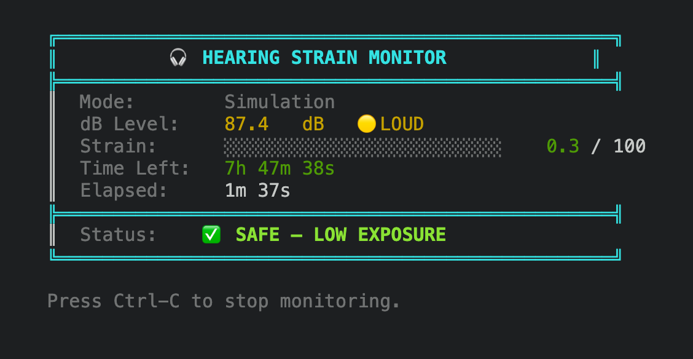
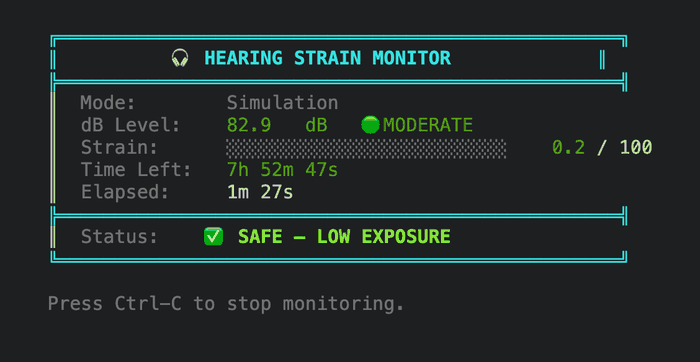

# Hearing Strain Monitor

Tracks cumulative hearing strain in real time by measuring ambient sound levels and computing a normalized exposure score (0–100). Estimates time remaining until a safe exposure threshold is reached based on current conditions.

Runs on a Raspberry Pi with an I2S MEMS microphone for live audio capture, or on any POSIX system in simulation mode for development and testing.



<details>
<summary>20 seconds of the live dashboard (simulation mode)</summary>



</details>

Captured from `make && ./hearing_monitor` on macOS.

## Hardware

### Components

| Part | Quantity | Notes |
|------|----------|-------|
| Raspberry Pi (3B+ / 4 / Zero 2W) | 1 | Any model with GPIO header |
| INMP441 I2S MEMS microphone | 1 | Or any I2S mic breakout |
| Green LED (5mm) | 1 | Safe indicator |
| Yellow LED (5mm) | 1 | Warning indicator |
| Red LED (5mm) | 1 | Danger indicator |
| Piezo buzzer | 1 | Active, 3.3V compatible |
| 330Ω resistor | 3 | One per LED |
| Breadboard + jumper wires | — | |

### Wiring

**I2S Microphone (INMP441):**

| INMP441 Pin | Pi Pin | BCM |
|-------------|--------|-----|
| VDD | 3.3V (pin 1) | — |
| GND | GND (pin 6) | — |
| SCK | pin 12 | GPIO 18 (BCK) |
| WS | pin 35 | GPIO 19 (LRCK) |
| SD | pin 38 | GPIO 20 (DATA) |
| L/R | GND | — (left channel) |

**LEDs and Buzzer:**

| Component | Pi Pin | BCM | Series Resistor |
|-----------|--------|-----|-----------------|
| Green LED | pin 11 | GPIO 17 | 330Ω |
| Yellow LED | pin 13 | GPIO 27 | 330Ω |
| Red LED | pin 15 | GPIO 22 | 330Ω |
| Piezo buzzer | pin 16 | GPIO 23 | — |

All LED cathodes and the buzzer ground connect to any GND pin on the Pi.

### Enabling I2S on the Pi

Add the following to `/boot/config.txt`:

```
dtparam=i2s=on
dtoverlay=i2s-mems
```

Reboot after saving. Verify the mic shows up with:

```
arecord -l
```

You should see a capture device on card 0.

## Dependencies

### Raspberry Pi

```bash
sudo apt update
sudo apt install libasound2-dev pigpio
```

The `pigpio` daemon does not need to be running — the program initializes it directly. You will need to run the binary with `sudo` for GPIO access.

### macOS / Linux (simulation mode)

No additional dependencies. Only requires `gcc`, `make`, and `pthreads` (included with any standard toolchain).

## Building

**Simulation mode** (macOS, Linux, or Pi without hardware):

```bash
make
```

**Raspberry Pi** (with I2S mic and GPIO hardware):

```bash
make pi
```

## Running

**Simulation:**

```bash
./hearing_monitor
```

**Raspberry Pi** (GPIO requires root):

```bash
sudo ./hearing_monitor
```

Press `Ctrl-C` to stop. The program will turn off all LEDs, close the audio device, join threads, and print final statistics.

## How It Works

Three threads run concurrently:

1. **Audio thread** — samples the microphone (or generates simulated values) at 1 Hz and writes the current dB level to a shared buffer.
2. **Processing thread** — reads new dB samples from the buffer, accumulates strain using `strain += db × dt`, normalizes to a 0–100 score, and estimates time remaining until the exposure threshold.
3. **Main thread** — refreshes a terminal dashboard every second and drives the GPIO indicators (green/yellow/red LED, buzzer on threshold).

All access to shared state is protected by a single pthread mutex. The audio thread sets an `updated` flag when it writes a new sample; the processing thread only computes when it sees this flag, preventing the same sample from being counted twice.

The exposure threshold is set so that 85 dB sustained for approximately 8 hours reaches 100%.

### GPIO Indicator Behavior

| Score | Green | Yellow | Red | Buzzer |
|-------|-------|--------|-----|--------|
| 0–59 | ON | off | off | off |
| 60–79 | off | ON | off | off |
| 80–99 | off | off | ON | off |
| 100 | off | off | ON | ON |

## Project Structure

```
├── main.c            Entry point, display loop, GPIO integration, signal handling
├── audio.c           Producer thread (ALSA capture on Pi, simulation otherwise)
├── audio.h
├── processing.c      Consumer thread (strain computation)
├── processing.h
├── gpio.c            LED and buzzer control (pigpio on Pi, no-ops otherwise)
├── gpio.h
├── shared.h          Shared data structures, constants, pin assignments
├── Makefile
└── README.md
```

## License

MIT
